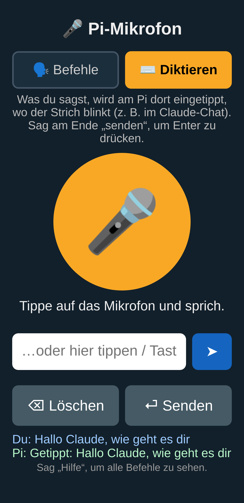

# 🎤 Smartphone-Mikrofon für den Raspberry Pi

Mit diesem kleinen Programm wird dein Handy zur Sprach-Fernbedienung für deinen Raspberry Pi.
Du sprichst ins Handy, und der Pi führt den Befehl aus (z. B. „Öffne YouTube“, „lauter“, „suche nach …“).

## Einrichten / Aktualisieren (am Raspberry Pi im Terminal einfügen)

```
echo start
wget -qO- https://raw.githubusercontent.com/marchens1977/Smartphone-Mikrofon/main/einrichten.sh | bash
echo ende
```

Danach startet das Programm automatisch mit dem Pi. Die Adresse fürs Handy steht im
Startmenü unter Zubehör → Smartphone-Mikrofon.

## Drei Modi

- **Befehle:** z. B. „Öffne YouTube“.
- **Diktieren:** Was du sagst, wird am Pi dort eingetippt, wo der Strich blinkt (z. B. im Claude-Chat).
  Sag am Ende „senden“, um Enter zu drücken.
- **Aufnahme:** Tonaufnahme mit dem Handy-Mikrofon. Roter Knopf = Start, nochmal = Stopp.
  Die Aufnahme wird am Pi im Ordner **Aufnahmen** (im Home-Ordner) gespeichert. Am Handy siehst
  du die Liste aller Aufnahmen: anhören, aufs Handy laden oder löschen.
  Während der Aufnahme den Handy-Bildschirm anlassen.

## Am Handy

1. Handy im selben WLAN wie der Pi.
2. Adresse in Chrome öffnen.
3. Warnung „Verbindung ist nicht privat“ → **Erweitert** → **Weiter zu … (unsicher)**.
4. Auf den grünen 🎤-Knopf tippen, Mikrofon erlauben, sprechen.

## Befehle

„Öffne Browser“, „Öffne YouTube“, „Starte Megabarsch“, „Suche nach …“, „Schreibe …“,
„Lauter“, „Leiser“, „Ton aus“, „Öffne Terminal“, „Öffne Dateien“, „Bildschirmfoto“,
„Wie spät ist es?“, „Hilfe“.

Für „Schreibe …“ einmalig installieren: `sudo apt install wtype xdotool`

Beenden: im Terminal **Strg + C**.


